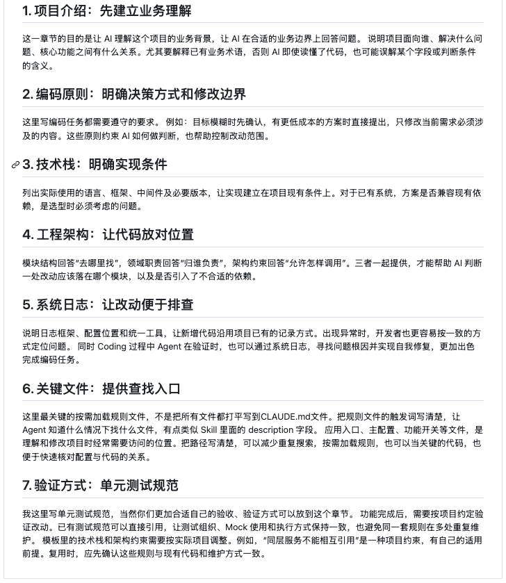

# AGENTS.md

[← 返回阅读入口](README.md) · [原帖](https://x.com/uudonX/status/2103255658519040391)

## 用户提供的帖文

以下保留用户提供的文字，未联网核对原帖。原文中的 `AGENT.md`、文件名变化与行数推荐写法均保留，不作为已核验的工具规范。

```text
看到 Claude Code 说支持 AGENT.md , 想起我刚开始用 AI 时打磨的项目说明书, 文件名称从 cursor -> codex -> claude, 现在稳定了, 很少改它了.

在一个跑了10年的30+万行代码、核心、微服务、复杂业务系统, 定义项目说明书 CLAUDE.md, 迭代了很多轮, 随着模型的升级已经非常精简了, 纯内容部分 不到 100 行(官方推荐不查超过200行)。
```

## 用户提供的截图



截图是结构说明，未提供所描述业务系统实际使用的完整配置文件。
